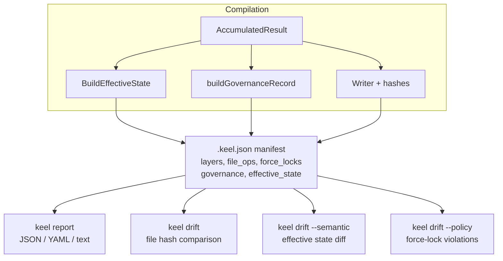

# Compliance & Reporting

The Keel compiler captures a complete record of every compilation in the `.keel.json` manifest.
This manifest is the single source of truth for compliance reporting, drift detection, and governance enforcement.

## Manifest as Single Source of Truth

After compilation, the `.keel.json` manifest contains:

- **Layer BOM** — complete layer stack with content hashes
- **File operations** — every file written with content hash and merge strategy
- **Force locks** — governance records for locked content
- **Governance record** — policy decisions made during compilation
- **Effective state** — authoritative compile-time snapshot
- **Dependencies** — installed binaries with paths and scope
- **Compilation metadata** — agent, scope, timestamp, Keel version

Every question about "what was compiled" can be answered from the manifest.

## Governance Record

The governance record captures policy decisions made during compilation:

```json
{
  "governance": {
    "permissions_policy": "additive",
    "mcp_policy": "last-writer-wins",
    "hook_lock_strategy": "locked-at-layer-2",
    "override_conflicts": [
      {
        "category": "commands",
        "key": "deploy.md",
        "layers": ["org-policy", "team-config"],
        "resolution": "force-lock"
      }
    ]
  }
}
```

This record shows:
- Which merge policies were applied
- Where conflicts occurred
- How conflicts were resolved
- Which governance mechanisms were triggered

## Effective State

Effective state is the authoritative compile-time snapshot of what was actually compiled.
It contains the final merged values for all configuration:

```json
{
  "effective_state": {
    "permissions": {
      "allow": ["Read", "Write"],
      "deny": []
    },
    "mcp_servers": {
      "server1": {
        "command": "npx",
        "args": ["-y", "@modelcontextprotocol/server-filesystem"]
      }
    },
    "hooks": {
      "SubagentStart": [
        {
          "command": "./hooks/start.sh",
          "background": false
        }
      ]
    },
    "settings": {
      "model": "claude-sonnet-4-20250514",
      "effortLevel": "high"
    },
    "instructions": "Full concatenated instructions content...",
    "categories": {
      "agents": ["ripp-builder.md", "ripp-writer.md"],
      "skills": ["keel-compile.md", "keel-validate.md"],
      "commands": ["deploy.md", "test.md"]
    }
  }
}
```

Effective state enables semantic drift detection — comparing what was compiled against what currently exists on disk.

## Compliance Reporting

The `keel report` command generates compliance reports from the manifest.

```bash
keel report --format json
keel report --format yaml
keel report --format text
```

The report includes:
- **Schema version** — report format version
- **Compilation metadata** — when, where, how it was compiled
- **Layer BOM** — complete layer stack with content hashes
- **Governance record** — policy decisions and conflict resolutions
- **Force locks** — what content is governed and locked
- **File operations** — every file with strategy and hash
- **Dependencies** — installed binaries with paths
- **Effective state** — authoritative compile-time snapshot

Example JSON report:

```json
{
  "schema_version": "1.0",
  "agent": "claude",
  "scope": "project",
  "compiled_at": "2026-05-19T10:30:00Z",
  "keel_version": "0.1.0",
  "layers": [
    {
      "name": "org-policy",
      "format": "keel",
      "source": "./layers/org-policy",
      "content_hash": "sha256:abc123..."
    }
  ],
  "governance": { ... },
  "force_locks": [ ... ],
  "file_ops": [ ... ],
  "deps": [ ... ],
  "effective_state": { ... }
}
```

Text reports are human-readable:

```
Compilation Report
==================

Agent:        claude
Scope:        project
Compiled at:  2026-05-19 10:30:00
Keel version: 0.1.0

Layer Stack
-----------
1. org-policy (keel) - ./layers/org-policy
   Hash: sha256:abc123...

Governance
----------
Permissions policy: additive
MCP policy: last-writer-wins
Hook lock strategy: locked-at-layer-2

Force Locks
-----------
commands/deploy.md - locked by org-policy

Files Written
-------------
CLAUDE.md (concatenate) - sha256:def456...
.claude/settings.json (deep-merge) - sha256:ghi789...
```

## Drift Detection

Drift detection compares the current disk state against the manifest.

### File Hash Comparison

All files are written with content hashes.
`keel drift` compares current file hashes against the manifest.

```bash
keel drift
```

Output:

```
  modified  CLAUDE.md
  missing   .claude/commands/deploy.md
  added     .claude/commands/debug.md

Error: drift detected
```

Every file gets a hash, not just user-editable files.
This enables precise drift detection for overlay files (commands, agents, skills).

### Semantic Drift

`keel drift --semantic` shows what changed in effective state.

```bash
keel drift --semantic
```

Output:

```
Semantic drift detected:

Permissions:
  + allow: Write (added)
  - allow: Delete (removed)

MCP servers:
  ~ server1: command changed from "npx" to "node"

Hooks:
  + SubagentStart: ./hooks/start.sh (added)

Settings:
  ~ model: "claude-sonnet-4" → "claude-opus-4"

Instructions:
  Content changed (1234 → 1456 bytes)

Categories:
  agents:
    + ripp-debug.md (added)
    - ripp-old.md (removed)
```

Semantic drift compares effective state against current disk state.
It shows what configuration changed, not just that something changed.

### Policy Drift

`keel drift --policy` checks only force-locked files.

```bash
keel drift --policy
```

This is useful for CI pipelines that only care about governance violations.

### Machine-Readable Output

`keel drift --format json` produces structured output for CI integration.

```json
{
  "drift_detected": true,
  "modified_files": ["CLAUDE.md"],
  "missing_files": [".claude/commands/deploy.md"],
  "added_files": [".claude/commands/debug.md"],
  "semantic_drift": {
    "permissions": {
      "added": ["Write"],
      "removed": ["Delete"]
    }
  }
}
```

## Compliance Story

```
              COMPLIANCE STORY

  "What was compiled?"         → keel report (from manifest)
  "Has it changed?"            → keel drift (file hash comparison)
  "What specifically changed?" → keel drift --semantic (effective state diff)
  "Were policies violated?"    → keel drift --policy (force-lock check)
```

Every question has a single authoritative answer from the manifest.

## Data Flow



The manifest is built during compilation.
All post-compilation tools consume it.
No separate tracking, no external state.

## Report Schema

The compliance report schema is versioned independently from the manifest schema.
Current version: `1.0`

Future schema versions will preserve backward compatibility.
Old reports can always be read, even after Keel upgrades.
