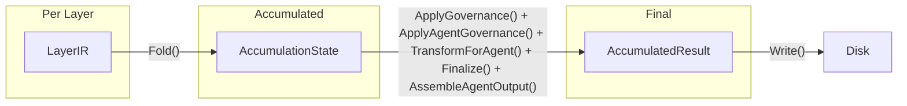
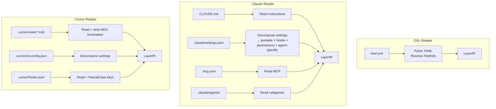
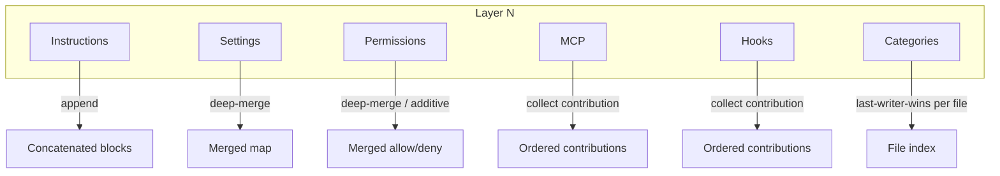
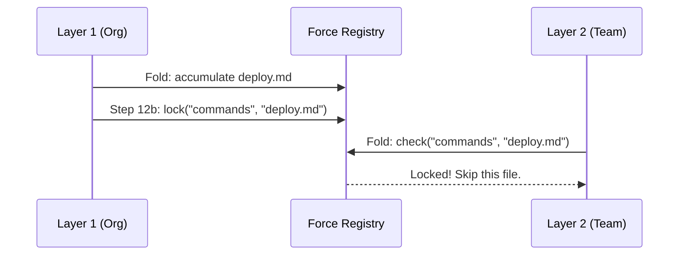

# Intermediate Representation

The IR is the format-neutral data structure that sits between layer parsing and agent-native output.
Every reader produces IR, every fold consumes it, and every writer serializes the final accumulated result.

## Purpose

The IR enables three things:

1. **Cross-format compilation** -- a Claude native layer can produce Cursor output (and vice versa) because both readers produce the same IR.
2. **Agent-neutral accumulation** -- the fold step merges layers without knowing which agent is the target.
3. **Round-trip fidelity** -- `keel import` reads native config into IR, then `SerializeIR` writes it back as a keel DSL layer.

## The Three IR Types



### LayerIR

One layer's content in normalized form.
Produced by readers, consumed by Fold.

| Field | Type | Description |
|-------|------|-------------|
| `Instructions` | `[]InstructionBlock` | Markdown content blocks |
| `Settings` | `map[string]any` | Portable settings (all Settings struct fields) |
| `AgentSpecific` | `map[string]map[string]any` | Per-agent settings from file references only |
| `Permissions` | `map[string]any` | `{"allow": [...], "deny": [...]}` |
| `Hooks` | `map[string]any` | PascalCase-keyed hook events |
| `MCP` | `map[string]any` | `{"mcpServers": {...}}` |
| `ContentBlocks` | `map[string][]InstructionBlock` | Agent-specific content sections (loop, worktree-include, etc.) |
| `ConfigBlocks` | `map[string]map[string]any` | Agent-specific config sections (environment, etc.) |
| `Categories` | `map[string][]CategoryFile` | Overlay files: agents, skills, commands, etc. |
| `Variables` | `map[string]string` | Template variables defined in this layer |
| `Snippets` | `map[string][]byte` | Reusable content blocks |
| `Deps` | `map[string]DepSpec` | External binary dependencies |
| `Bin` | `[]BinFile` | Files for `.keel/bin/` |
| `Attribution` | `*CanonicalAttribution` | Portable attribution config |
| `Sandbox` | `*SandboxConfig` | Portable sandbox config |
| `SourceAgent` | `string` | Which agent format this was read from |

### AccumulationState

All layers collected as contributions.
MCP, hooks, settings, categories, and file policies stored as ordered contributions (not yet governed or agent-specific).
Content blocks and config blocks collected by name.

This is the internal working state of the compilation pipeline.
It becomes agent-specific only after `TransformForAgent()` runs.

### AccumulatedResult

The final output, fully resolved and ready for serialization.
Variables substituted, conditionals evaluated, snippets expanded, governance applied.

Consumed by agent-specific writers.

## Readers

Each reader normalizes a different input format into the same `LayerIR`:



### Reader normalizations

| Concern | Claude Reader | Cursor Reader |
|---------|---------------|---------------|
| Hook keys | PascalCase (pass-through) | camelCase → PascalCase |
| Permissions | Bare names (pass-through) | Strip trailing `(*)` suffix |
| Instructions | Read `CLAUDE.md` | Read `.mdc`, strip frontmatter |
| Settings | Extract hooks + permissions from `settings.json` | Separate files |
| Attribution | Template strings → canonical | Boolean flags → canonical |
| Sandbox | Embedded in settings → canonical | Separate file → canonical |

## Merge Strategies in Fold

The fold applies different merge strategies by content type:



| Content | Strategy | During Fold | During ApplyGovernance | During TransformForAgent | During Finalize |
|---------|----------|-------------|------------------------|--------------------------|-----------------|
| Instructions | Concatenate | Collect blocks | — | — | Variable substitution |
| Settings | Deep-merge | Collect contributions | Deep-merge with force-lock enforcement | — | Variable substitution |
| Permissions | Deep-merge (additive option) | Collect contributions | Deep-merge with force-lock enforcement | — | Variable substitution |
| MCP | Contribution model | Collect contributions | — | — | Filter conditions, then deep-merge |
| Hooks | Contribution model | Collect contributions | — | Apply strategy (last-writer-wins or additive) | Variable substitution |
| Categories | Last-writer-wins per file | Collect contributions | Overlay with force-lock enforcement | Prune unsupported, translate frontmatter | Variable substitution |
| ContentBlocks | Concatenate | Collect blocks | — | Populate metadata | Variable substitution |
| ConfigBlocks | Deep-merge | Collect blocks | — | — | Variable substitution |
| Variables | Last-writer-wins | Collect per key | — | Set `keel.agent` | — |

## Agent-Specific Content

Before generalization, the IR had dedicated typed fields for agent-specific content: `Loop`, `WorktreeInclude`, `Environment`.
This design required IR changes every time a new agent-specific feature was added.

Now the IR uses two generic maps:
- **ContentBlocks** — `map[string][]InstructionBlock` for text content (loop, worktree-include)
- **ConfigBlocks** — `map[string]map[string]any` for JSON config (environment)

Agent profiles declare which blocks they support via `ContentBlockDef` and `ConfigBlockDef`:

```go
type ContentBlockDef struct {
    Name           string  // map key: "loop", "worktree-include"
    JoinSeparator  string  // how to join blocks: "\n\n"
    OutputPath     string  // where to write: ".claude/loop.md"
}

type ConfigBlockDef struct {
    Name       string  // map key: "environment"
    OutputPath string  // where to write: ".cursor/environment.json"
}
```

Adding a new agent-specific feature:
1. **Schema** — add `[]schema.FileRef` field to `KeelConfig`
2. **Reader** — call `readContentBlock("name", config.Field)` or `readConfigBlock("name", config.Field)`
3. **Profile** — add block definition to profile's `ContentOutputs` or `ConfigOutputs`
4. **Capability** — set capability flag if needed

No IR changes needed.
Generic accumulation and writing handles the rest.

## Governance in the IR

### Force-locks

Force-locks prevent downstream layers from overwriting governed content.
They are tracked per category and key in the `forceRegistry`.



Force-locks apply to: settings files, individual hook events, MCP servers, category files, and file policies.

### _keel policies

JSON files can carry `_keel` metadata for merge governance:
```json
{"_keel": {"merge": "additive"}, "allow": ["Read"]}
```

Policies are processed during fold (strip from content, apply to merge behavior) and stripped from agent-native output unless `--distributable` preserves them.

## What's Next

- **[Compilation Pipeline]()** -- end-to-end flow with multi-agent and implicit layers.
- **[Adding an Adapter]()** -- how to build a new agent adapter.
- **[Merge Strategies]()** -- detailed merge behavior.
