# Compilation Pipeline

How Keel transforms layered configuration into agent-native output.

## High-Level Flow

Every `keel compile` follows the same pipeline regardless of how many agents are targeted.

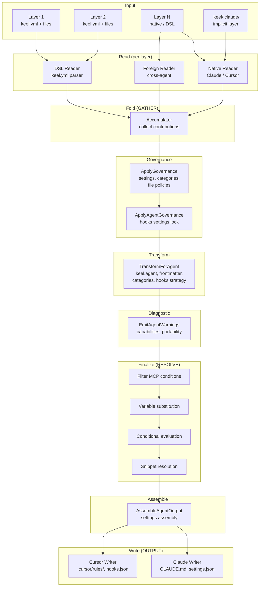

## Pipeline Phases

### 1. Read

Each layer is read into a `LayerIR` by the appropriate reader.
The reader selection depends on the layer's format:

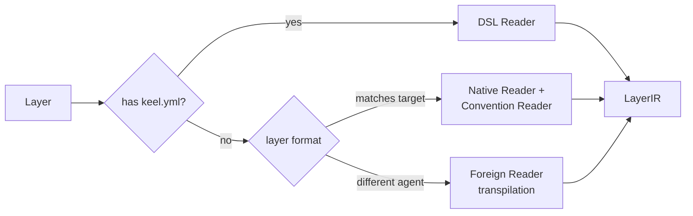

| Reader | When used | Cacheable? |
|--------|-----------|------------|
| DSL Reader | Layer has `keel.yml` | Yes (agent-independent) |
| Native Reader | Format matches target agent | No (agent-specific) |
| Foreign Reader | Format is a different agent | No (transpilation) |
| Convention Reader | `FormatKeel` without `keel.yml` | No (wraps native) |

When compiling for multiple agents, DSL layer reads are cached and reused.
Native and foreign layer reads run per-agent since they produce different IRs.

### 2. Fold

The accumulator is a **pure merge engine** with zero agent knowledge.
It merges each layer's IR into accumulated state using content-type-specific strategies.

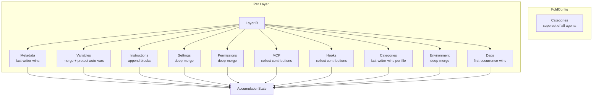

The fold only has `FoldConfig { Categories []CategoryDef }`.
No agent name, no agent-specific flags.
MCP, hooks, settings, categories, and file policies are all collected as **ordered contributions** (not merged) so that governance and agent-specific processing can happen in separate phases.

### 3. ApplyGovernance

Processes all contributions collected during fold in fold-index order.
This enforces governance policies (force-locks, merge strategies) independently of agent identity.

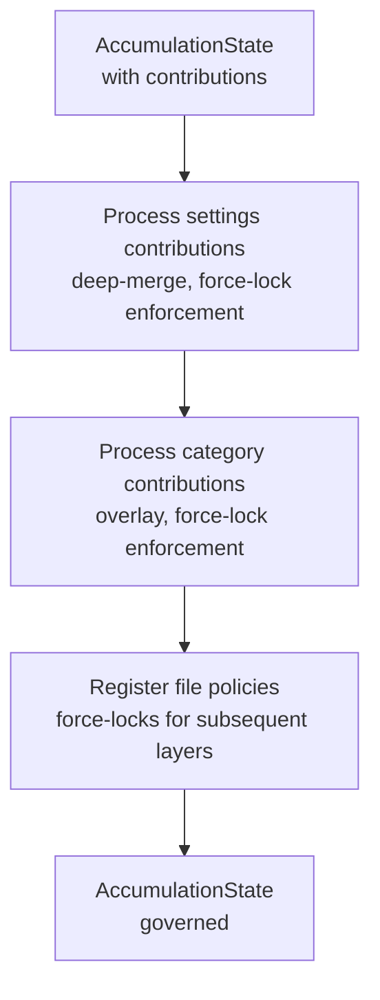

This phase maintains the original fold ordering: a layer's own content is accepted before its force-locks affect subsequent layers.

### 4. ApplyAgentGovernance

Agent-specific governance that requires knowledge of the target agent.
Currently handles hooks settings lock filtering.

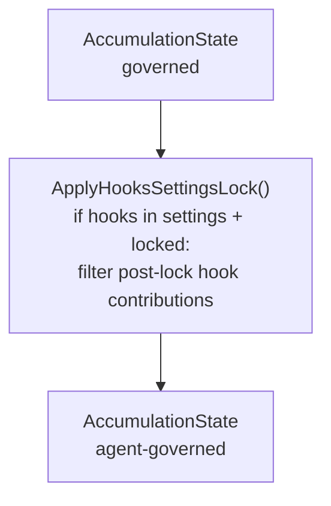

### 5. TransformForAgent

All agent-specific structural transforms happen here.
This is where agent identity enters the pipeline for content transformation.

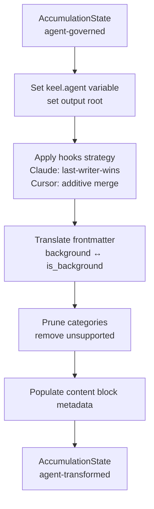

### 6. EmitAgentWarnings

Diagnostic warnings for capability and portability issues.
Non-destructive — only adds warnings to the accumulation state.

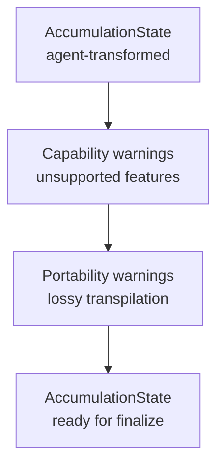

### 7. ProcessDeps

Dependency installation and variable injection.
Installs external binaries, verifies them, and injects `keel.deps.<name>.path` and `keel.deps.<name>.dir` variables.

### 8. Finalize

Template resolution runs on the agent-transformed accumulated state.
The `keel.agent` variable is now set, so agent-conditional content resolves correctly.
MCP condition filtering happens here with full variable access.

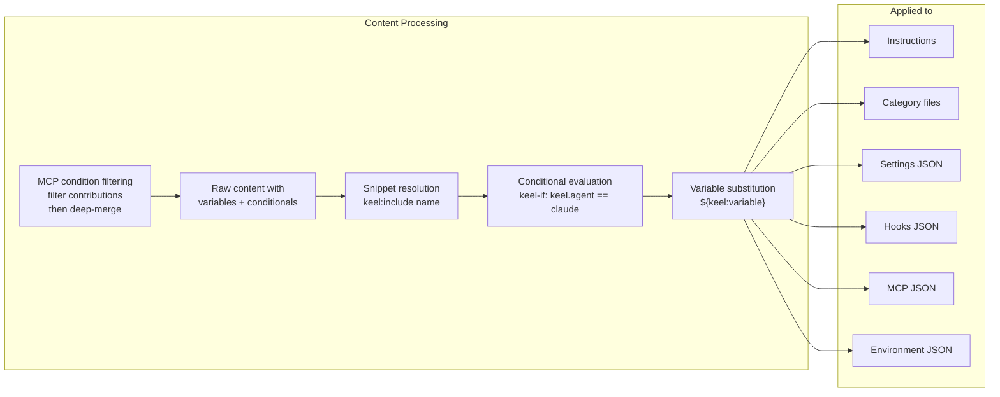

### 9. AssembleAgentOutput

Settings assembly runs after finalization and before writing.
This phase merges settings, permissions, hooks, sandbox, attribution, and MCP policy into the final settings map using profile-driven assembler functions.

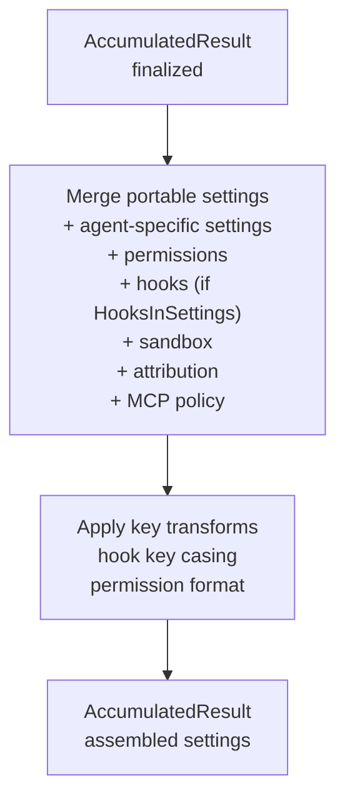

The assembler uses the agent profile's `SettingsDefaults` (e.g., Cursor's `version: 1`) and `SettingsAssembler` function to produce agent-specific settings structure.

### 10. Write

Each agent's writer serializes the `AccumulatedResult` to disk.
Writers contain no merge logic, no variable substitution, no governance enforcement, and no settings assembly.
They are pure serializers.
Common output (categories, content blocks, config blocks) is handled by `WriteCommonOutput`.
All files are written with content hashes for drift detection.

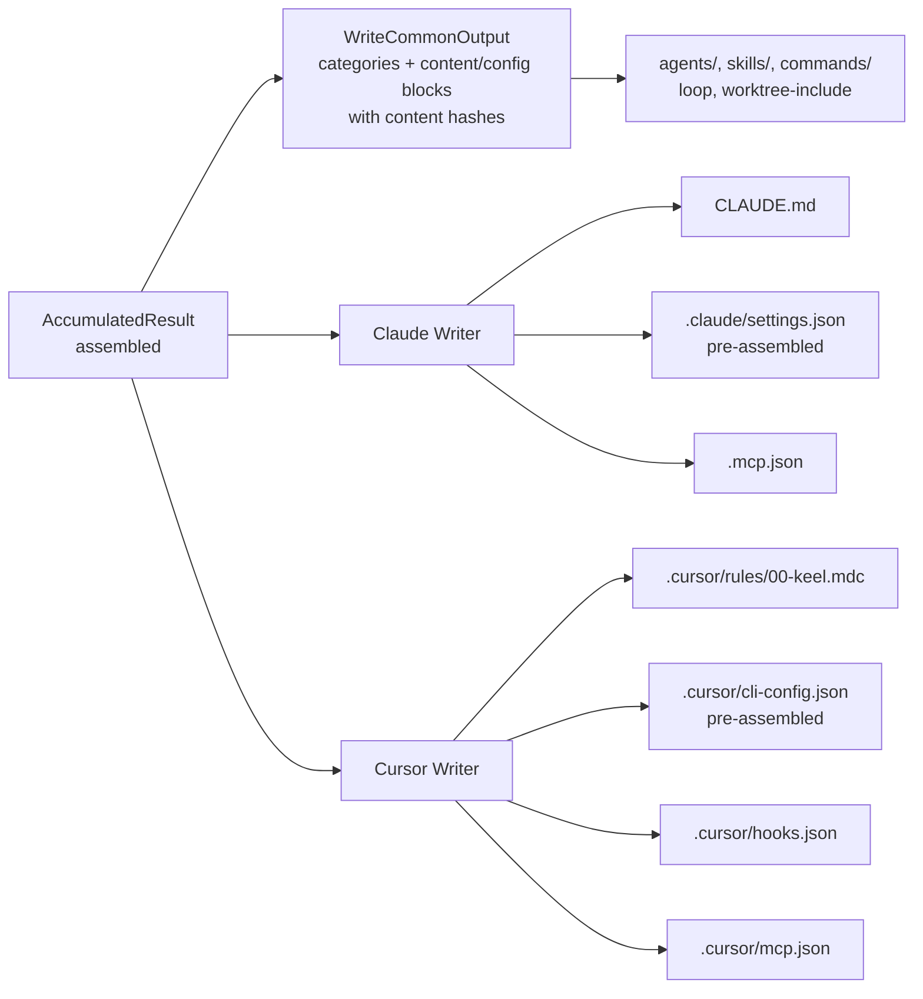

## Post-Compilation

After writing files to disk, the compiler captures a complete record of what was compiled.
This record powers compliance reporting, drift detection, and governance enforcement.

### Compliance Story

```
              COMPLIANCE STORY

  "What was compiled?"         → keel report (from manifest)
  "Has it changed?"            → keel drift (file hash comparison)
  "What specifically changed?" → keel drift --semantic (effective state diff)
  "Were policies violated?"    → keel drift --policy (force-lock check)
```

### Data Flow

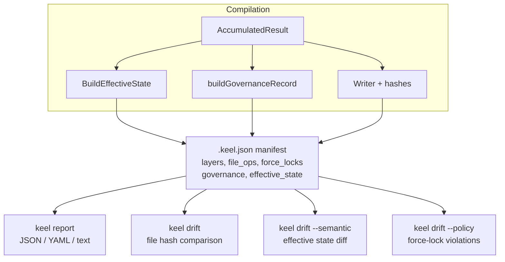

The manifest contains:
- **Layer BOM** — complete layer stack with content hashes
- **File operations** — every file written with content hash and strategy
- **Force locks** — governance records for locked content
- **Governance record** — policy decisions (permissions policy, MCP policy, override conflicts, hook lock strategy)
- **Effective state** — authoritative compile-time snapshot (permissions, MCP servers, hooks, settings, instructions, categories)
- **Dependencies** — installed binaries with paths and scope

All files get content hashes, not just user-editable files — this enables precise drift detection for overlay files (commands, agents, skills).

## Multi-Agent Compilation

When compiling for multiple agents (`--output claude=. --output cursor=.`), the `CompileMulti` function shares work across agents.

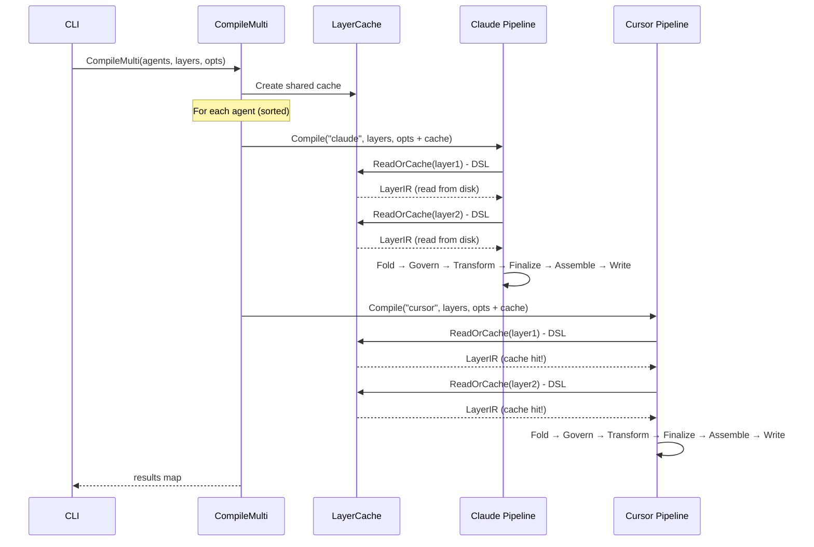

DSL layers are read once and reused.
Each agent gets its own `AccumulationState` — fold is cheap (in-memory map merges).

## Implicit Native Layers

During compilation, Keel checks for a `.keel/<agent>/` directory (e.g., `.keel/.claude/`) and automatically includes it as the lowest-priority layer if it exists. This directory can be manually populated with native configuration files that should serve as defaults.

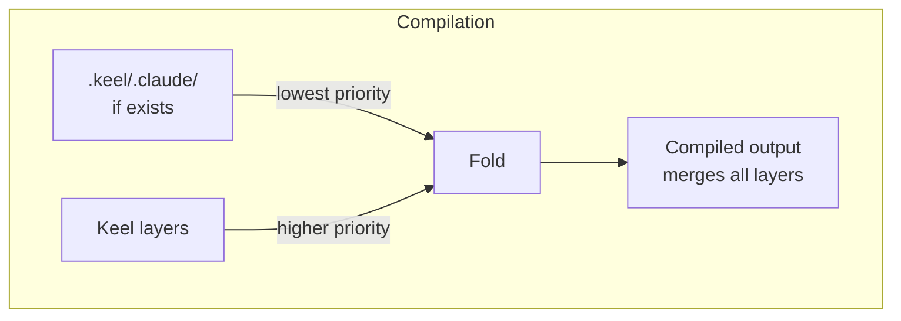

The implicit layer directory is never automatically created or modified by Keel — it must be manually populated if needed.

## Clean and Manifest

`keel clean` uses the `.keel.json` manifest to reverse compilation.

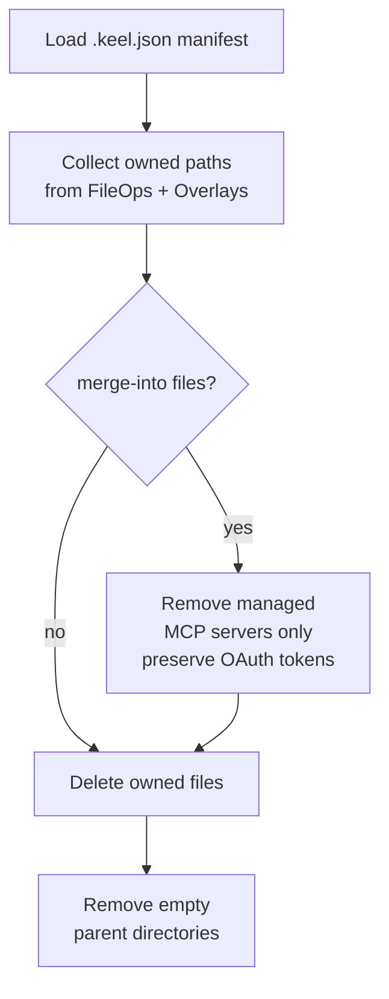

## Prune (Incremental Compile)

On subsequent compiles, `PruneStaleOutput` removes files from the previous compile that are no longer produced.

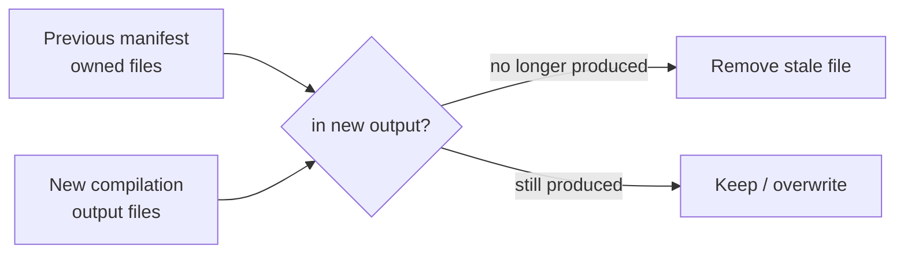

## Governance: Force-Locks

Force-locks prevent downstream layers from overwriting governed content.

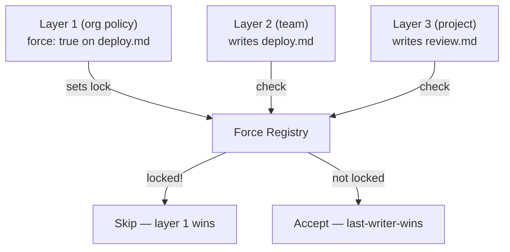

Force-locks work across all content types: settings, hooks, MCP servers, categories, and file policies.
They are tracked in the manifest and stripped from agent-native output (unless `--distributable`).

## Data Types Through the Pipeline

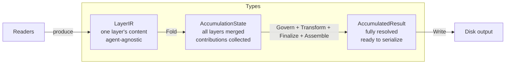

| Type | Created by | Consumed by | Agent-specific? |
|------|-----------|-------------|-----------------|
| `LayerIR` | Readers | Fold | No (format-neutral) |
| `AccumulationState` | Fold | ApplyGovernance, ApplyAgentGovernance, TransformForAgent, EmitAgentWarnings, ProcessDeps, Finalize | No until TransformForAgent |
| `AccumulatedResult` | Result() | AssembleAgentOutput, Writers | Yes (post-TransformForAgent) |
| `CompileResult` | CompileWithProfile | Manifest writer, CLI | Yes (includes file records) |

## Import Flow

`keel import` converts native agent config into a keel DSL layer.

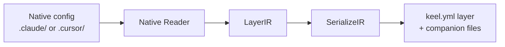

The same IR that powers compilation also powers import.
No separate conversion logic — read into IR, serialize from IR.
